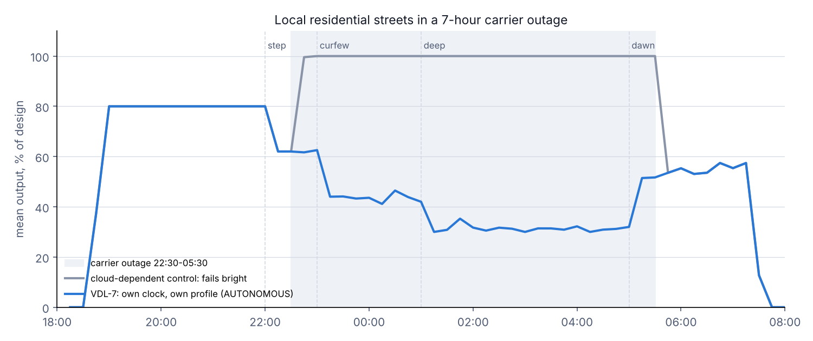
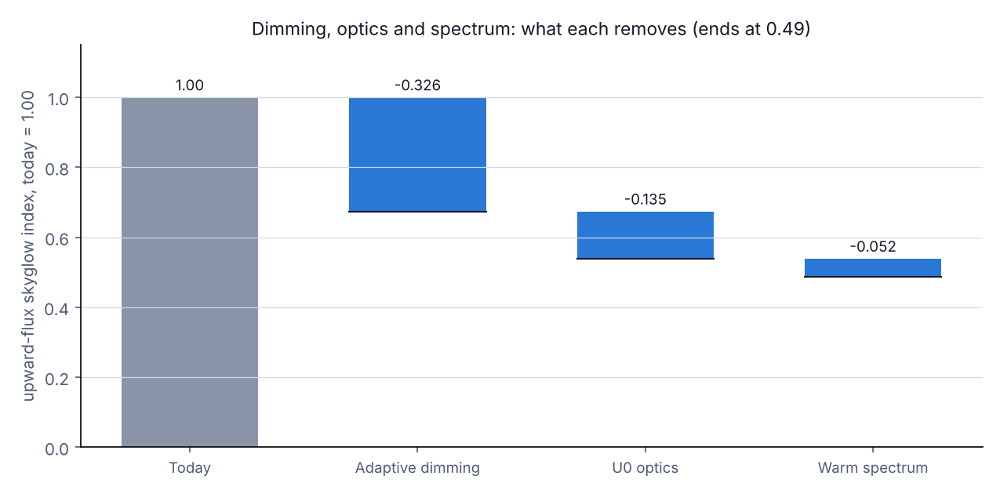

# Nocturne engineering reference

[Back to the README](../README.md)

These implementation notes retain the detailed specification comparisons and simulation results from the original README. Reported results describe the documented model runs, not field measurements. Test counts below describe those runs; use `python -m pytest -q` for the current suite.

## The control loop (Section 2.4)

`VDL7Controller.tick(mono, dt)` runs once per second and determines everything the node does:

| Step | What the code does | Spec |
|---|---|---|
| 1 Mode | `SAFE` if the RTC isn't trusted; `ONLINE` if backhaul heard ≤ 15 min ago; `MESH` if a gateway path is ≤ 15 min old; otherwise `AUTONOMOUS` | 5.2 |
| 2 Lit | Lit when the sun is below −3° on the node's own clock **or** the photocell reads dark. The photocell can switch lights on early but can never hold them off. In SAFE mode the photocell alone decides | 2.4 |
| 3 Phase | Local civil hour on the city's own POSIX TZ rule gives the phase, which gives the base level: the class's, or its neighbourhood zone's from the signed bundle. On a migration night, presence classes hold their 22:00 level | 2.2 *(zones and migration are extensions)* |
| 4 Activity | Loop volume ÷ design volume, used only in ONLINE or MESH and only while under 15 min old. Presence (90 s) or carpet (60 s) sets A = 1 on occupancy classes, A ≥ 0.5 on arterials and collectors | 2.3, 5.2 |
| 5 Raise | `target = max(base, base + (cap − base) × A)` | 2.4 *(clamped, see below)* |
| 6 Weather | Rain: `max(target, min(cap, target + 15))`; fog and snow are logged with no boost | 2.3 |
| 7 Floor | Class floor; 60 % on the High-Injury Network | 2.2 |
| 8 Emergency | 100 % inside an active, addressed geofence | 2.3 |
| 9 Override | Highest priority wins; only incident-command priority can pull an emergency below 100 %. Who, when and why are logged | 2.4, 5.4 |
| 10 Slew | Up 25 %/s, down 1 %/s | 2.4 |
| 11 CLO | drive = level × (0.86 → 1.00 over 100,000 h) | 2.4 |
| 12 Output | Two DALI channels with the tunable-white mix; NC relay; DALI failure level; checkpoint every 60 s; alarms; 15-min metering | 4.3, 5.1, 5.2 |

## Where this code departs from the spec, and the spec text to change

An independent review of the first version against the spec found places where following the spec literally is unsafe or ambiguous. The code fixes each one, and each has a test.

1. **Activity and rain could dim a street (§2.4 steps 5–6).** For the local, alley and park classes the evening level is above or at the boost cap (local: 80 vs 70). Read literally, `base + (cap − base) × A` takes a local street from 80 to 70 % when a pedestrian walks in, and rain takes a park edge from 60 to 50 %. The code clamps both so they never lower the light (`EXT-DIM-4`). **Spec change:** add `max(base, …)` to steps 5 and 6.
2. **SAFE mode could misplace the curfew after a long cut (§5.2, §5.3, R-FS-3).** Per §5.2 the clock is lost only when the supercap drains, after more than 7 days. A flash checkpoint from before such a cut can't be dated, yet using it as if no time had passed moved the curfew by however long the power was off. The checkpoint now stores the RTC counter, and the node resumes from it only when the counter rode through the cut and can measure the gap (`R-FS-3`). After an RTC reset the node holds the 22:00 level until its photocell sees dusk (`EXT-FS-5`). **Spec change:** R-FS-3 should state that the RTC counter survived the cut.
3. **SAFE mode ran 8 minutes early (§5.3 step 5).** It counted from the photocell dusk but used a midpoint learned from the −3° sun. The node now learns the midpoint and night length from its photocell's own dusk and dawn on clocked nights. The clockless curfew lands at 22:58 (`R-FS-3`, `EXT-FS-4`).
4. **A dead node on the High-Injury Network fell below 60 % (§5.2).** The driver failure level is now the higher of the class's 22:00 level and 60 % on HIN segments (`EXT-FS-6`).
5. **Signed messages need more than a signature (§2.3, §5.4).** See *Message security* below for the design.
   - Every event is addressed to one street segment, optionally narrowed to the geofence nodes within it, and nodes ignore anything else. Malformed targets match nothing (`EXT-SEC-5`, `EXT-SEC-10`).
   - Events carry the segment's sequence number, checked against an anti-replay window kept in flash (`EXT-SEC-6`, `6b`, `6c`).
   - With a trusted clock, an event expires at issue time + TTL, not receipt + TTL. Nodes refuse events that expired before they arrived or claim a future issue time (`EXT-SEC-7`, `EXT-SEC-11`). A loop count also counts its age from issue, so a late delivery cannot extend its boost (`EXT-SEC-17`).
   - A cancel that overtakes its event (the backhaul copy beating the mesh copy) is remembered for a day, and the late event is refused rather than running its full TTL. Only copies issued before the cancel are refused, so an id the CMS reuses later still works (`EXT-SEC-16`).
   - Bundles are type-checked and bounds-checked against firmware-minimum floors, completeness, mix sums and the 400-day validity before they are stored. The HIN floor must lie between 60 and 100 %, design watts must be positive, and a bundle dated more than a day ahead is not valid, so its 400 days cannot be pushed out of reach. The anti-rollback version survives even a fall back to the factory profile (`EXT-SEC-3`, `4`, `12`, `13`, `18`, `19`).
   - When the store is full, emergencies and overrides are evicted last, and unknown event kinds are ignored (`EXT-SEC-8`).
   - Override audit records (who, when, why, cancelled) go to the CMS (`EXT-SEC-9`).
6. **Weather must not teach the node a false dusk (§5.3).** A photocell dusk or dawn more than 45 min from the sun's is treated as weather and not learned. In SAFE mode, a dusk more than 45 min off yesterday's is replaced by the expected time, unless a second observation confirms it (`EXT-FS-9`, `EXT-FS-10`, `EXT-FS-12`; see *SAFE mode without a clock*).
7. **Number corrections.** §6.2 says "24 acceptance tests"; the firmware suite (`tests/test_controller.py`) has 92, and the city tools, command line and console add 217 more. The table's 18 rows become 19 tests, because R-MESH-1/2 is split in two; the rest are extensions. The Section 6.3 and Section 4 figures are reconciled below.
8. **The clock is hard-wired to one city (§2.4, R-CLK-1).** The spec compiles in `EST5EDT`. The node now carries any POSIX TZ rule (`NodeConfig.tz`). Where the sun never crosses −3° (Tromsø in December, Reykjavik in June), the learning code used to crash; now the lights follow the sun and nothing is learned from a night with no dusk (`EXT-CLK-4` to `10`). **Spec change:** make the rule a commissioning parameter.

## Acceptance suite

`test_R_*` covers the 18 rows of the Section 6.2 table, with R-MESH-1/2 split into two tests. `test_EXT_*` covers requirements stated elsewhere in the spec that the table omits, plus the safety fixes above.

| Section 6.2 row | Test checks |
|---|---|
| R-CLK-1 | Firmware POSIX DST rule matches the IANA database at every 6-hour step, 2024–2030 (10,228 checks) |
| R-CLK-2 | Sunrise and sunset in Oct, Dec and Jun within 3 min; dusk and dawn are the −3.00° crossings; the controller switches on at that crossing with the photocell blinded |
| R-CLK-3 | Trusted at 1 year, not at 4; never before the first sync; 7-day supercap; longer cut resets the clock and counter |
| R-DIM-1 | Arterial at 60 % at 23:30 |
| R-FS-1 | Total outage: AUTONOMOUS, local street at 30 % at 01:00 |
| R-FS-2 | Backhaul-only loss: MESH mode applies an emergency at 100 % |
| R-FS-3 | Power cut at 21:00 zeroes the monotonic clock; from the photocell and checkpoint alone the node lands the curfew within 10 min (actual: 2 min early) |
| R-ADP-1 | Local street 30 → 70 % in under 2 s, back to 30 % after hold and fade |
| R-ADP-2 | Arterial at 50 % + 50 % × (150/300) = 75 % |
| R-ADP-3 | Loop boost kept for one 15-min slot after backhaul loss, then dropped |
| R-SAF-1 | HIN floor wins over the rain boost |
| R-SAF-2 | Fog and snow: no boost |
| R-SAF-3 | A blocked photocell cannot keep the lights off at night |
| R-SAF-4 | Storm darkness at 14:00 under 3 lx: lights on at the evening level (and at 10:00, `R-SAF-4b`) |
| R-EM-1 | Emergency in SAFE mode expires on monotonic time |
| R-EM-2 | A planned override cannot lower an emergency; incident command can; cancelling restores it |
| R-CLO-1 | Drive 86 % new, 100 % at 100,000 h |
| R-MESH-1/2 | 12-hop budget; broken-path isolation; 3-hop carpet |

The extensions cover:
- **Dimming:** the full table, DST and phase boundaries, the boost clamp.
- **Fail-safe:**
  - clockless cold boot and RTC reset;
  - a hung controller falling to the HIN-aware failure level through the driver watchdog;
  - one hello leaving SAFE, and loop handling by mode;
  - storm darkness rejected while learning and in SAFE mode.
- **Adaptive:** presence on arterials, the light carpet.
- **Security:**
  - forged, tampered, unsafe, wrongly typed, expired and rolled-back bundles;
  - misaddressed, malformed, replayed, reordered and stale events, and CMS failover;
  - store eviction, cancellations, override priority, and the audit trail.
- **Tunable white:** the full mix.
- **Hardware:**
  - photocell 15/40 lx with 60 s debounce, and the 0–10 V path;
  - tilt, driver-fault, day-burner, cycling and stuck-photocell alarms;
  - metering that survives a dead link and a reboot;
  - hour meter and tilt baseline kept in flash.
- **Spectral:** limits, and round-tripping a measured spectrum.

The tests can be run locally with `python -m pytest -q`. This repository currently has no GitHub Actions test workflow.

### Beyond the firmware

| File | Tests | What they hold the code to |
|---|---|---|
| `tests/test_anycity.py` | 73 | **The POSIX rule engine against the IANA database.** For every zone one recurring rule can run, 2027–2030, mid-month and one second either side of every transition. Each of the 17 presets is checked every 6 h, 2024–2030. **Rule forms:** Jn/n, quoted names, `/24` and negative-DST. **Curfew at 23:00 local:** Sydney, Adelaide, Paris, Tucson. **Polar latitudes:** polar night and the midnight sun. **SAFE mode:** in the southern hemisphere. **Zones:** overlays, refused unsafe overlays (including non-finite numbers and names that do not fit the MCU), and the HIN floor inside a dark zone. **Migration nights**, which never dim storm darkness. **Fold-0 local time** for negative DST, and dusk at the edge of polar night. **Commissioning** refuses a zone whose rule misses the zone's own listed changes. |
| `tests/test_photometry.py` | 13 | Zonal lumens against closed forms; LM-63 corners ([MORE], spacing, bad numbers); symmetry expansion, including a 90–270 file without 180; front/back split and trespass on either street side; Type V only for light that repeats every 90°; TM-15 thresholds; inverse-square and cosine laws; window trespass; globes vs reflector retrofits |
| `tests/test_annual.py` | 10 | One night against the 400-node simulation; the year's shape; the order of the strategies; the unsensed floor; any city, including polar ones; break-even over every pole; no payback for part of a year; each class's CCT mix; Phase 0 equal to the exported programmes sample for sample |
| `tests/test_schedule.py` | 16 | Phase 0 programmes keep every floor and the signed levels, including High-Injury Network variants held at the HIN floor, step with traffic to the latest dawns, read across midnight, export with zones, and are exactly what the business case integrates; floors outside 0–100 % and fractional zone levels are refused |
| `tests/test_skyglow.py` | 12 | Kernel against the closed-form near field (0.5 %); near and far slopes, and beyond the table; aerosol-free air; no step at a cell's edge; the DC grid against the fleet; every lever in the right direction; calibration; the streetlights-alone vs shared-curfew claim; retrofit ranking; input checks; the stored LED spectra |
| `tests/test_observe.py` | 13 | The Moon against PyEphem at the 2026 eclipses; log formats, including comment lines, extra fields and headerless files; twilight, Moon and cloud filters; a planted 0.12 mag curfew effect recovered from a season of synthetic readings with clouds and moonlight; a null effect; one estimate kept when the other lacks nights |
| `tests/test_pilot.py` | 10 | DC's 12,096 segments randomised reproducibly and in balance; the exact test's size and power; the brake; **a seasonal 15 % harm that pooling hides and the period-stratified brake catches**; the stratified p-value against enumeration; its size with a season; tallies from a plan and a crash list; the power formula |
| `tests/test_nightsignal.py` | 8 | Phase times through the fall-back night and in Sydney; signature; what each kind of light is told; iCalendar (escaped, folded, never empty); migration alerts reaching the streetlights only when they cover the night; polar night and the midnight sun |
| `tests/test_inventory.py` | 11 | The DC inventory reduction: static lights left out, missing wattages filled from their peers, CCT labels, and the committed aggregates against each other |
| `tests/test_console_parity.py` | 1 | The console's JavaScript controller against the Python one: level, drive, white, amber, mode and phase on every 10 s tick of 19 scenarios, including outages, a modem fault on the mesh, SAFE nights after a learned night, tunable white and an incident-command override. Skipped without Node.js |
| `tests/test_formats.py` | 10 | LM-63 editions from 1986 to 2019 (the 2019 file generation type is never a multiplier), byte-order marks; plan and assignment CSVs that round-trip commas and quotes; per-site calendar UIDs; headerless TESS-W and SQM logs |
| `tests/test_cli.py` | 40 | Every command's documented output stays machine-readable; 31 kinds of bad input give a one-line error and exit 2, never a traceback; trace times after midnight and `--every`; the brake's file checks |

## Simulation results (Section 6.3)

`sim/run_night.py` uses the spec's layout (and reproduces every earlier scenario to the last digit after this version's firmware changes): 4 streets × 20 poles per class at 30 m spacing, 400 VDL-7 nodes, run through the night of 13–14 October 2026 in 10-second steps. A modelled CMS sends 15-minute hellos and one signed loop-volume message per segment. Seeded pedestrians walk 4–14 poles. Results are scaled to 75,000 lights by the Section 6.4 class mix.

| Scenario | Energy vs today | Spec 6.3 | Light vs today | Spec 6.3 | Skyglow index |
|---|---|---|---|---|---|
| Today: static 100 %, current CCT | 1.00 (55.6 MWh) | 1.00 | 1.00 | 1.00 | 1.00 |
| Adaptive dimming only | 0.67 | 0.65 | 0.67 | 0.65 | 0.67 |
| + U0 optics | 0.67 | 0.65 | 0.67 | 0.65 | 0.54 |
| + warm spectrum (full Nocturne) | 0.73 | 0.70 | 0.67 | 0.65 | 0.49 |
| Full Nocturne, 7-hour carrier outage | 0.70 | 0.68 | 0.65 | 0.63 | 0.47 |
| Same hardware, cloud-dependent control, same outage | 1.02 | 1.00 | 0.95 | 0.92 | 0.70 |
| Full Nocturne, CAD incident on one local street | 0.73 | — | 0.68 | — | 0.49 |
| Full Nocturne, rain 23:00–02:00 | 0.77 | — | 0.71 | — | 0.51 |
| Full Nocturne, heavy-migration night (Night Signal at 18:00) | 0.71 | — | 0.65 | — | 0.48 |

The skyglow waterfall goes 1.00 → −0.326 (dimming) → −0.135 (U0 optics) → −0.052 (warm spectrum) → **0.49**. The saving is 15.1 MWh per night, about **5.5 GWh a year** if every night were an October night on the spec's assumed fleet. `vdl7/annual.py` replaces both assumptions: on DC's real fleet (3.95 MW at commissioned full output, against the spec's 4.44 MW) over every night of a real year, the adaptive saving is 5.5 GWh (16.4 → 10.9 GWh).

**How these compare with the spec.** Every row is within 2–3 points of the printed Table 6.3, but they don't match exactly, and the spec's prose figures should be updated to these or to a re-run on real DDOT data:

| Spec says | This version |
|---|---|
| 35 % less light | 33 % |
| 30 % less energy | 27 % |
| About 6 GWh a year (16.8 MWh per night) | 5.5 GWh (15.1 MWh per night) |
| Spectrum step "4 points" of skyglow | 5 points |

The boost clamp explains 0.8 of a point: with it removed, the dimming row is 0.661 / 0.663. The rest of the gap isn't identified, and the run that produced the printed table isn't available to compare against.

The cloud-dependent row now uses the same luminaires as the outage row, so it isolates the control architecture. Failing bright for seven hours costs 30 points of delivered light: 0.95 against 0.65.

## Spectral model (Section 4)

`vdl7/spectral.py` builds generic LED spectra on the Planckian locus:
- white: a 450 nm pump plus two broad phosphor bands, fitted to Duv ≈ 0;
- PC-Amber: a 600 nm phosphor with a 0.4 % residual pump;
- narrow-band amber.

For each spectrum it computes, per photopic lumen:
- Rayleigh scatter;
- skyglow weighted by scotopic sensitivity;
- Mie (λ⁻¹·³) scatter;
- CIE S 026 melanopic DER.

The model comes close to the Section 4 claims for 3000 → 2700K: −11 % perceived skyglow against the spec's −10 %, and −12.5 % melanopic against −11 %. It matches PC-Amber exactly: −75 % and −85 %. **It does not reproduce the 2700 → 2200K figures:**

| 2700 → 2200K | Spec §4 | Model |
|---|---|---|
| Perceived skyglow | −22 % | −30 % |
| Melanopic | −23 % | −35 % |

**Mie scatter also differs:**

| Mie scatter, 2200K | Spec §4 | Model |
|---|---|---|
| vs 4000K | 4 % less | about 10 % less |
| vs 3000K | "about the same" | 5 % less |

Both metrics are dominated by the 450–520 nm region, so small differences in pump and phosphor shape move them a lot. Neither set of numbers is a measurement. Load the LM-79 spectra of the engines you'll actually procure with `nocturne spectral --spd name=file.csv` and use those figures in Section 4.

## Message security (Sections 2.1, 2.3, 5.4)

The spec already groups nodes by street segment, with one LwM2M message per segment. The protocol follows that grouping:

- **Signing.** The CMS signs every bundle and event with Ed25519. Nodes verify before storing anything. Mesh relays forward the original bytes and never re-sign.
- **Addressing.** Every event names one segment and, for a geofence, the nodes within it. A 400 m CAD geofence spanning three segments goes out as three messages with the same event id.
- **Sequencing.** The sequence number is the CMS's counter *for that segment*, with a failover epoch in the high 32 bits. Each node keeps a 64-wide sliding window over its own segment's counter. The window tolerates reordering among the few messages a segment gets, however much traffic the rest of the city generates. A standby CMS that lost the counters bumps the epoch.
- **Freshness.** With a trusted clock, events expire at issue time + TTL. In SAFE mode, receipt + TTL is the only clock available.
- **Cancels.** A cancel is remembered for the longest TTL an event may carry (24 h), so a copy of its event that arrives late is refused. Copies issued after the cancel (a higher sequence number) are not affected.
- **Acknowledged uplink.** Metering, alarms and audit records stay in a flash outbox until the CMS acknowledges them. A link that dies before the node notices loses nothing.

## SAFE mode without a clock (Sections 5.2, 5.3)

On every clocked night the node records the local time of its photocell's dusk and dawn, and keeps the midpoint and night length in flash. Transitions more than 45 min from the sun's are treated as weather and not learned. In SAFE mode it estimates the night-hour as **learned midpoint + (time since photocell dusk − previous night length / 2)**, so it counts from the same kind of dusk it learned from.

If it reboots mid-night, it resumes from the 60-second flash checkpoint plus the gap the RTC counter measured. If the counter itself was lost, it holds the 22:00 level until the next dusk.

On the second and later clockless nights, a dusk more than 45 min off the previous one is replaced by the expected time, unless a second observation puts dusk there too: the dusk actually seen the evening before, or the last dawn plus the learned length of the day. Then the reference itself was weather, and this dusk replaces it. On the first clockless night there is nothing to compare against, so storm darkness that runs straight into night will start that night's count early; the next dusk agrees with that night's dawn, so later nights are not affected (`EXT-FS-12`). Accuracy after a long outage also degrades with the season, by roughly 1–2 minutes per day of outage near the equinoxes, until the next time sync.

## Porting notes

- The loop keeps fixed-size state: a 64-entry event store, a 64-bit replay bitmap, a 672-record uplink ring in flash, and 256-line log and audit rings.
- It reads no wall clock outside `tick` and `receive`, and keeps every timer in monotonic seconds.
- On the MCU, the replay-window top belongs in FRAM or the secure element's monotonic counter, because it is written on every accepted event. The DALI failure level is written only when it changes.
- Python allocates small lists per tick; the C port should use static buffers.

## Known limits

Three independent reviews (firmware and time, physics and optics, statistics and data) re-derived the code's results with their own scripts. Every finding they confirmed is fixed and has a test; the most serious was a safety brake that pooled the wedge's periods and could miss a real harm. What remains is below.

**Firmware**
- Carpet events between neighbouring nodes are not signed here. The spec's device keys would sign them, but that is out of scope for this model.
- The CMS side (TALQ, LwM2M, DTLS) is modelled only by the messages it signs. Phase 0 still needs the schedule translated into the import format of DC's central management system.

**Business case**
- The baseline assumes DC's lights run at their commissioned maximum all night. A dimming schedule already in place would shrink the Phase 0 saving by its own amount.
- Price and grid factor are ASSUMED inputs. Activity uplift is the expected value of the Section 6.4 traffic and pedestrian curves, not DDOT counts.
- 635 poles have no wattage in the asset layer; each is given the median of its class and fixture style (`wattage_imputed_poles` in `data/dc/fleet.json`).

**Sky model**
- Single scattering only: no Earth curvature, terrain or buildings. That is adequate inside a city and optimistic beyond about 30 km.
- Aerosol load, ground reflectance, luminaire efficacy and the globes' uplight are ASSUMED. The globes' uplight should come from the installed kit's LM-63 file via `nocturne bug`.
- The streetlights' share of DC's sky is Tucson's until DC's own meters calibrate it.

**Optics**
- BUG ratings follow IES TM-15-11 Addendum A, with thresholds checked against their published reproduction. Ratings for procurement should still come from the manufacturer's accredited LM-79 file.
- The trespass check measures light on the outside of the window, before glass and curtains.

**The rest**
- **Night Signal.** A protocol proposal: no owner is bound by it until the District says so.
- **Crash data.** The pilot's power figure uses the District's 2025 crash count. The layer's timestamps are ambiguous between UTC and local time, so the night-time share is given as a range.
- **The brake's input.** `nocturne brake` takes one row per night-time crash with its street segment. The rule that assigns a crash to a segment (the layer's own segment id, or the nearest lit segment) should be fixed and published with the seed, before the draw.
- **Places.** The coordinates of the six places are approximate centroids.

## License

MIT. See `LICENSE`.
